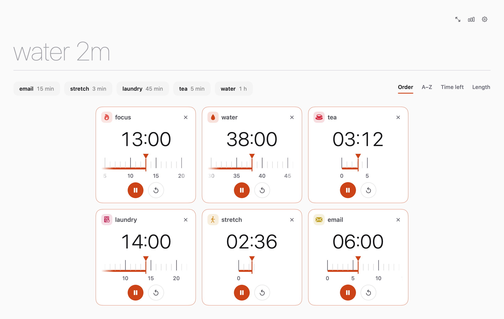
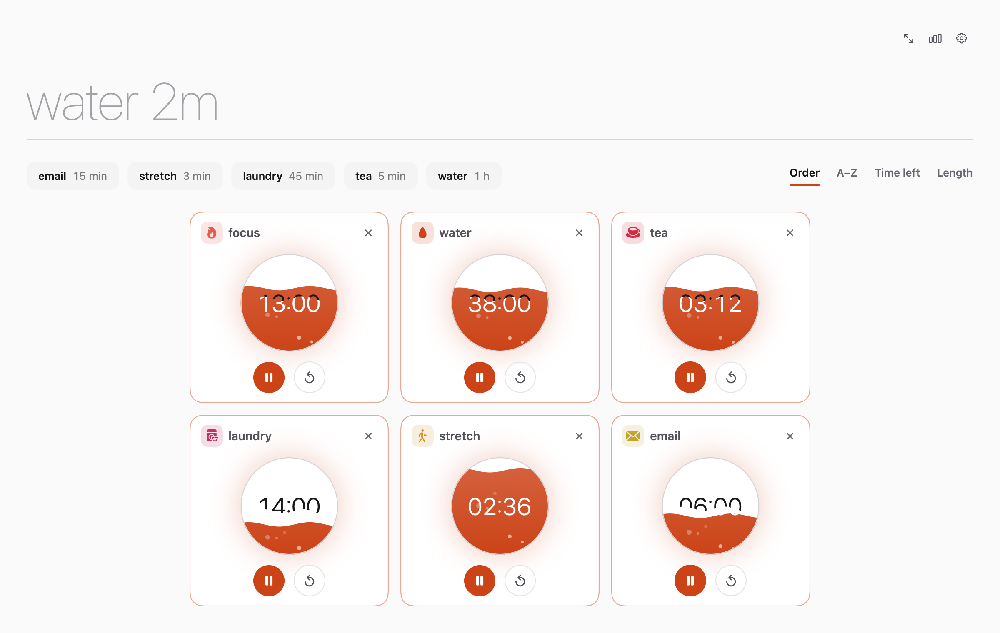
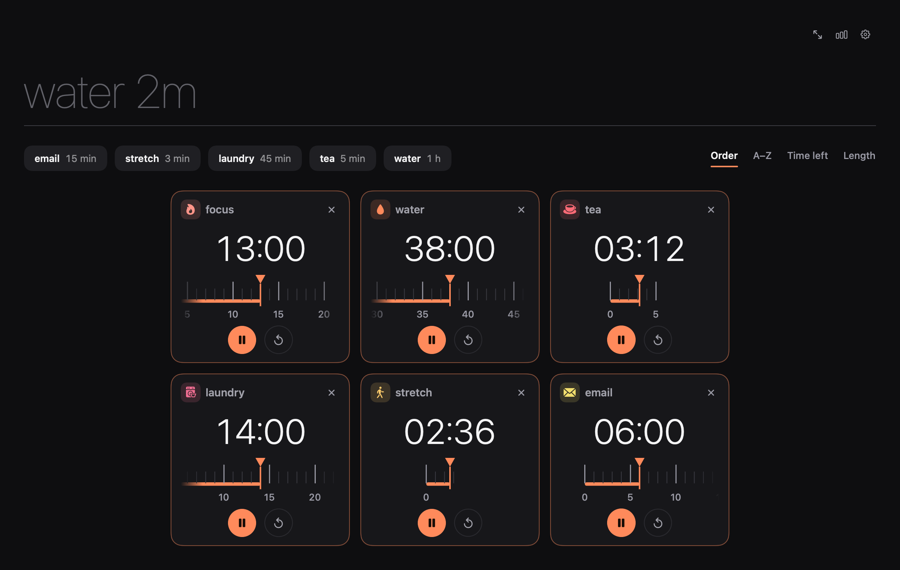

<p align="center">
  
</p>

<h1 align="center">Ember</h1>

<p align="center">
  Timers that feel good. Type <code>water 2m</code>, press Return, done.<br>
  A calm, native macOS timer app: as many timers as you need, in one window.
</p>

<p align="center">
  <a href="../../releases/latest/download/Ember.dmg"><b>Download for macOS</b></a>
  &nbsp;·&nbsp; macOS 14+ &nbsp;·&nbsp; Apple silicon &amp; Intel &nbsp;·&nbsp; MIT
</p>

<p align="center">
  
</p>

## What it does

- **Say it like a sentence.** `water 2m`, `focus 20min`, `20 min focus`, `tea 1h30m`, `eggs 90s`. The name and the time are pulled out of whatever you type.
- **One window, any number of timers.** Cards resize to fill the window and never scroll. Resize, go fullscreen, add one more: they glide to their new places and stay sharp.
- **Quick timers that learn.** Timers you name show up as one-tap chips, most used first. It starts with `focus 20m`, `water 1h` and `break 5m`.
- **Five ways to watch time.** Halo, Mono, Tide, Cinder and Tape. Switch live in Settings.
- **Distraction-free mode.** One click (or ten idle minutes) hides everything but the timers.
- **You can't miss a finished timer.** It pulses like a heartbeat and rings on repeat until you press ✓ or ↻.
- **A little personality.** Optional per-timer glyphs (symbols, monograms, patterns or blinking buddies) in colours drawn from your accent theme.
- **Sorting.** Order, A–Z, time left, length. Click again to reverse.
- **Lives in the menu bar.** Closing the window keeps your timers running. Dock progress and a menu-bar countdown show the next one due.
- **Remembers everything.** Timers (even running ones), quick timers, history and settings survive a quit or a restart.
- **Light by default**, dark and system modes, four accent colours.

<p align="center">
  
  
</p>

## Install

1. Download **[Ember.dmg](../../releases/latest/download/Ember.dmg)** from the [latest release](../../releases/latest).
2. Drag Ember to Applications.
3. The first time, right-click Ember and choose **Open** (see below).

### Why the first-launch warning?

Ember is signed ad hoc, not with a paid Apple Developer ID, so macOS Gatekeeper asks you to confirm the first launch. Right-click → Open → Open, once. Or from Terminal:

```sh
xattr -dr com.apple.quarantine /Applications/Ember.app
```

## Using it

| Do this | To |
|---|---|
| Type `water 2m` + Return | Start a timer named *water* for two minutes |
| Tap a chip under the text line | Start that timer again |
| Edit a card's name, ⏸ ▶ ↻ ✕ | Manage a timer |
| ✓ / ↻ on a finished card | Stop the alarm and close it / restart it |
| Order · A–Z · Time left · Length | Sort; click the active one to reverse |
| Expand button, or idle for 10 minutes | Distraction-free mode (Esc or the faint corner button exits) |
| Chart button | Stats: finished timers, streak, last 7 days |
| ⌘, | Settings: timer theme, glyphs, accent, mode, alarm sound and volume, notifications, launch at login |

Quit from the Dock menu, the menu-bar popover, or ⌘Q. Closing the window does not quit.

## Build from source

Requires macOS 14+ and Xcode (or the Command Line Tools). No Xcode project: it's a Swift package plus a script that assembles the app bundle.

```sh
scripts/run.sh            # build and launch
scripts/test.sh           # unit tests
scripts/dmg.sh            # build/Ember.dmg
UNIVERSAL=1 scripts/dmg.sh   # Apple silicon + Intel
```

If you haven't accepted Xcode's license, `scripts/env.sh` falls back to the Command Line Tools, so everything above still works.

### Layout

```
Sources/EmberCore   timers, name+time parser, quick-timer ranking, stats (no UI, fully tested)
Sources/Ember       SwiftUI app: window, menu bar, themes, glyphs, settings
Tests/              Swift Testing
scripts/            run, test, bundle, dmg, release
docs/               landing page (GitHub Pages) and screenshots
```

`Ember --screenshots <dir>` renders the images in `docs/screenshots` headlessly.

## Releasing

Pushes to `main` build and test, and keep a DMG as a workflow artifact. A public release happens only when you cut one:

```sh
scripts/release.sh minor     # or patch / major: bumps VERSION, commits, tags
git push origin main --follow-tags
```

The tag triggers the Release workflow, which builds a universal DMG and publishes it with generated notes. The landing page's download button always points at the newest release.

## Design

`docs/design/mocks.html` has the five original design directions the themes came from. [DESIGN.md](DESIGN.md) has the principles.

## License

[MIT](LICENSE)
